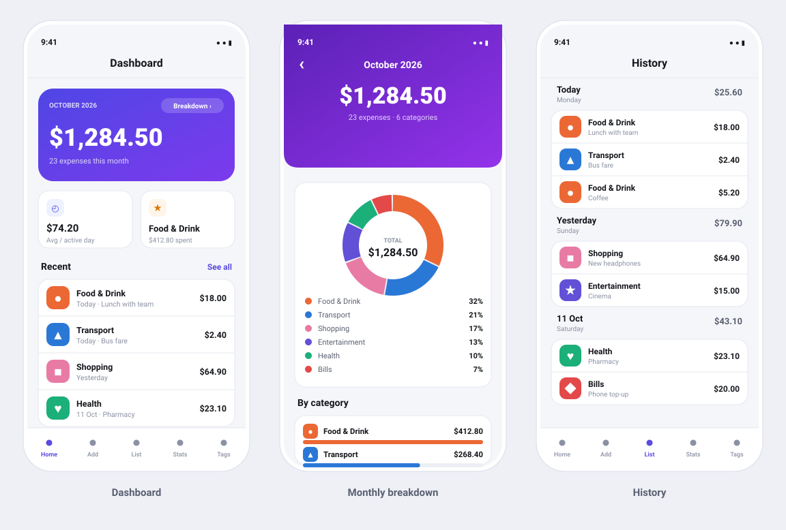

<p align="center">
  
</p>

<h1 align="center">Expense Tracker</h1>

<p align="center">
  <b>Know where your money goes.</b><br>
  A personal spending tracker — a Flask REST API with an Expo / React&nbsp;Native app on top.
</p>

<p align="center">
  
  
  
  
  
  
</p>

---

<p align="center">
  
</p>

<p align="center">
  <sub><i>Design mockups drawn from the app's real theme tokens — not photographs of a running device.</i></sub>
</p>

---

## ✨ What it does

| | |
|---|---|
| 📊 **Dashboard** | This month's total as a hero figure, plus average spend per active day and your biggest category |
| 🍩 **Monthly breakdown** | A donut for share-at-a-glance, backed by ranked bars for the precise comparison |
| 🗓 **Day-grouped history** | Expenses bucketed by day with a running total on every day header |
| 🏷 **Custom categories** | Pick a colour, and the icon is chosen automatically from the name |
| 🎨 **Accessible by design** | The category palette is validated so no two colours are hard to tell apart, including for colourblind users |
| 📱 **Zero config on device** | The app finds your backend by itself — no IP address to type in |

## 🚀 Quick start

You'll need **Python 3.14**, **Node 20+**, and the [Expo Go](https://expo.dev/go) app on your phone.

**1 — Start the API**

```powershell
cd backend
py -m venv .venv                      # first time only
.\.venv\Scripts\Activate.ps1
pip install -r requirements.txt       # first time only
python main.py                        # serves on port 8000
```

**2 — Seed the default categories** (once, in a second terminal, while the API runs)

```powershell
cd backend
.\.venv\Scripts\Activate.ps1
python seed.py
```

**3 — Start the app**

```powershell
cd mobile
npm install                           # first time only
npm start
```

Scan the QR code with Expo Go, or press `a` / `i` for an emulator. That's it — the app
reuses the host Expo served it from, so there's no IP address to edit.

> 💡 **If the app says "Cannot reach the backend"**, it's almost always Windows
> Firewall. See [Troubleshooting](#-troubleshooting) below for the one-line fix.

## 🧪 Tests

```powershell
cd backend
.\.venv\Scripts\Activate.ps1
pip install -r requirements-dev.txt   # first time only
python -m pytest tests -v
```

21 tests covering every endpoint. They run against a throwaway database in your temp
folder, so they never touch your real `spending.db`, and no server needs to be running.

---

<details>
<summary><b>🔌 API reference</b></summary>

<br>

| Method | Route | Notes |
|---|---|---|
| `GET` | `/health` | Liveness check |
| `GET` | `/categories/` | All categories, sorted by name |
| `POST` | `/categories/` | `{"name": "Food", "colour": "#eb6834"}` |
| `DELETE` | `/categories/<id>` | **Also deletes that category's expenses** |
| `GET` | `/expenses/` | All expenses, newest first |
| `POST` | `/expenses/` | `{"amount": 12.5, "date": "2026-10-11", "note": "Lunch", "category_id": 1}` |
| `DELETE` | `/expenses/<id>` | |

Dates are `YYYY-MM-DD`. Errors come back as JSON: `{"error": "..."}`.

</details>

<details>
<summary><b>🛠 Troubleshooting</b></summary>

<br>

**"Cannot reach the backend"**

For the phone to talk to your PC, all three must be true:

1. Phone and PC on the **same Wi-Fi network**.
2. The backend running — `python main.py` binds `0.0.0.0`, not just localhost.
3. Windows Firewall allowing inbound TCP on port 8000. Run once in an **elevated** PowerShell:

   ```powershell
   New-NetFirewallRule -DisplayName "Expense Tracker API" -Direction Inbound `
     -Protocol TCP -LocalPort 8000 -Action Allow -Profile Private
   ```

**`ModuleNotFoundError: No module named 'flask'`**

The virtual environment isn't active. Look for `(.venv)` at the start of your prompt.
Either activate it, or call its Python directly — `.\.venv\Scripts\python.exe main.py`.

**The app crashes on startup**

Clear the Metro cache: `npx expo start -c`.

> `index.js` must stay the `main` entry, and its `react-native-url-polyfill/auto`
> import must stay **first**. React Native's built-in `URL` exposes `protocol` as a
> getter with no setter, but `expo-asset` assigns to it at module load — without the
> polyfill loading first, the app dies with
> `TypeError: Cannot assign to property 'protocol' which has only a getter`.

</details>

<details>
<summary><b>📁 Project layout</b></summary>

<br>

```
backend/
  main.py              app factory, JSON error handler, /health
  database.py          engine + session (DATABASE_URL overridable for tests)
  models.py            Category, Expense
  routers/             categories.py, expenses.py
  seed.py              inserts the six default categories
  tests/               pytest suite
assets/
  mascot.svg           Pob — source art for this page and the app icons
  preview.svg          the mockups above
mobile/
  assets/              icon.png, adaptive-icon.png, favicon.png (generated from mascot.svg)
  index.js             entry point — installs the URL polyfill, then mounts App
  App.tsx              tab + stack navigation, theme wiring
  src/theme.ts         colours, spacing, radii — the validated category palette
  src/categoryIcons.ts picks an icon from a category name, by keyword
  src/api/             client.ts (host autodetect), categories, expenses, summary
  src/hooks/           useExpenses, useBottomSpace
  src/components/      CategoryAvatar, DonutChart, Loading / ErrorNotice / EmptyState
  src/screens/         Home, Add, History, Summary, Settings, MonthDetail
  src/utils/format.ts  money and date formatting
  src/types/           shared TypeScript interfaces
```

</details>

<details>
<summary><b>🏗 How it fits together</b></summary>

<br>

```
mobile/   React Native app (Expo)  ──HTTP──>  backend/  Flask API  ──>  spending.db
```

The app talks to the API over your local network; the API owns the SQLite database.
Because the data lives on your PC rather than the phone, you can wipe and reinstall
the app without losing anything.

</details>

---

<p align="center">
  <sub>Built as a learning project. Pob supervises.</sub>
</p>
